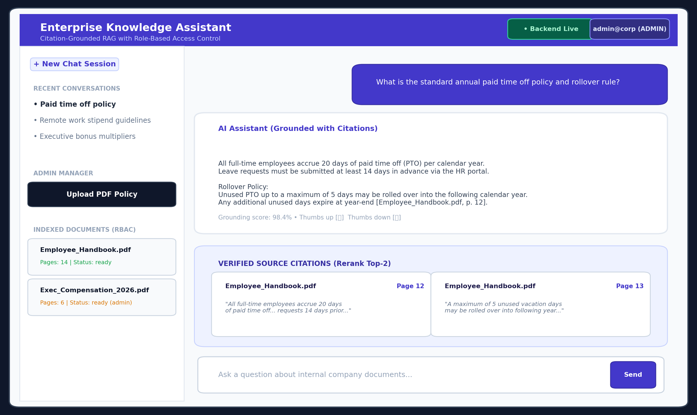
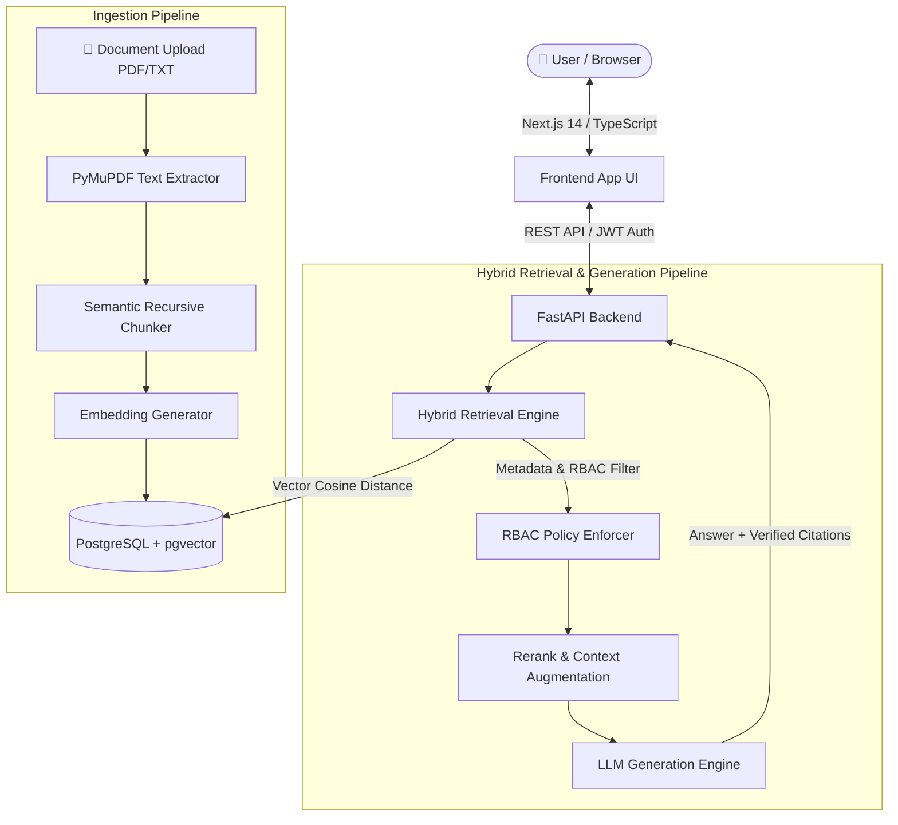
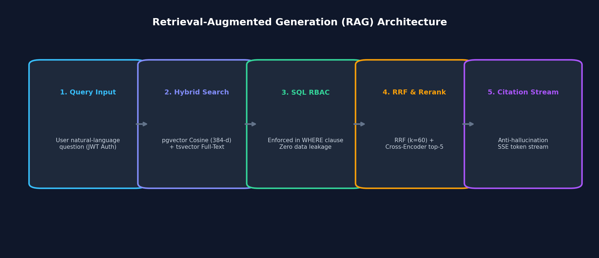

<div align="center">

# 🧠 Enterprise RAG Assistant
### *Grounded, High-Performance Knowledge Retrieval with Role-Based Access Control*

[](https://fastapi.tiangolo.com)
[](https://nextjs.org/)
[](https://www.postgresql.org/)
[](https://github.com/pgvector/pgvector)
[](https://www.typescriptlang.org/)
[](https://tailwindcss.com/)
[](LICENSE)

<br/>

**Built with passion by [Dina Kauthankar](https://github.com/Dina-Kauthankar)**

[Explore Features](#-key-features) • [System Architecture](#-system-architecture) • [Quick Start](#-quick-start) • [API Documentation](#-api-endpoints) • [Contributing](#-contributing)

<br/>



</div>

---

## 📖 Overview

The **Enterprise RAG Assistant** is a production-grade, full-stack Retrieval-Augmented Generation application engineered for enterprise document intelligence. It ingests internal policies, contracts, technical specifications, and proprietary manuals, enabling authorized personnel to query company knowledge using natural language.

Every AI response is strictly **grounded with verifiable citations**, complete with page-level traceability and document attribution. Built-in **Role-Based Access Control (RBAC)** guarantees that sensitive confidential files (e.g., executive compensation, legal disputes, board minutes) are strictly shielded from unauthorized roles during retrieval.

---

## ✨ Key Features

- 🔍 **Hybrid Retrieval Engine**: Fuses dense vector similarity search (`pgvector` cosine embeddings) with sparse keyword matching (Reciprocal Rank Fusion) for maximum semantic and exact-phrase recall.
- 🎯 **Page-Level Grounding & Citations**: Direct citations link generated answers to explicit source document pages, eliminating hallucinations and ensuring auditability.
- 🛡️ **Role-Based Access Control (RBAC)**: Fine-grained security (`admin`, `manager`, `employee`, `contractor`). Document embeddings are isolated and filtered directly at database query execution.
- ⚡ **Asynchronous Document Ingestion**: Fast extraction and chunking of PDF, TXT, and DOCX documents with metadata enrichment and automatic vectorization.
- 💬 **Interactive Chat Experience**: Clean, responsive UI featuring real-time query processing, markdown rendering, citations sidebar, document preview drawer, and feedback logging (thumbs up/down).
- 🔐 **JWT Token Authentication**: Secure session management and password hashing via bcrypt.

---

## 🏗️ System Architecture



<div align="center">
  
</div>

---

## 🗂️ Project Structure

```text
rag-assistant/
├── backend/
│   ├── app/
│   │   ├── api/             # FastAPI REST route controllers (auth, chat, documents, feedback)
│   │   ├── core/            # Configuration, database session, JWT security
│   │   ├── models/          # SQLAlchemy ORM models (User, Document, Chunk, Citation)
│   │   ├── schemas/         # Pydantic schemas for data validation
│   │   ├── services/        # Ingestion, embedding generation, hybrid retrieval logic
│   │   └── main.py          # Application entrypoint & CORS middleware
│   ├── tests/               # Pytest suite for API endpoints and retrieval verification
│   ├── requirements.txt     # Python dependencies
│   └── .env.example         # Environment template
├── frontend/
│   ├── src/
│   │   ├── app/             # Next.js 14 App Router pages (layout, page, login)
│   │   ├── components/      # React components (ChatInterface, Sidebar, Navbar, UploadModal)
│   │   ├── context/         # AuthContext and state management
│   │   └── config.ts        # API configuration & endpoint constants
│   ├── package.json         # Node.js dependencies
│   └── tailwind.config.js   # Tailwind styling configurations
├── docs/
│   └── assets/              # High-resolution screenshots and architectural diagrams
├── generate_screenshots.py  # Automation script for generating preview assets
└── README.md                # Project documentation
```

---

## 🚀 Quick Start

### 📋 Prerequisites

Ensure you have installed:
- **Python 3.10+**
- **Node.js 18+** & npm
- **PostgreSQL 14+** with `pgvector` enabled

---

### 1️⃣ Database Setup

Create a PostgreSQL database and enable the vector extension:

```sql
CREATE DATABASE rag_db;
\c rag_db;
CREATE EXTENSION IF NOT EXISTS vector;
```

---

### 2️⃣ Backend Installation & Launch

```bash
# Navigate to the backend directory
cd backend

# Create and activate virtual environment
# Windows:
python -m venv venv
venv\Scripts\activate

# Linux / macOS:
# python3 -m venv venv
# source venv/bin/activate

# Install dependencies
pip install -r requirements.txt

# Configure environment variables
copy .env.example .env
# Edit .env with your PostgreSQL credentials & secret keys

# Run database setup / initial seed (optional)
# python -m app.initial_data

# Start FastAPI server with live reload
uvicorn app.main:app --reload --port 8000
```

> 💡 **Backend is running at:** `http://localhost:8000`  
> 📑 **Interactive Swagger Docs:** `http://localhost:8000/docs`

---

### 3️⃣ Frontend Installation & Launch

Open a new terminal window:

```bash
# Navigate to the frontend directory
cd frontend

# Install npm dependencies
npm install

# Start Next.js development server
npm run dev
```

> 🌐 **Frontend is running at:** `http://localhost:3000`

---

## 🔌 API Endpoints

| Category | Method | Endpoint | Description | Access |
|---|:---:|---|---|:---:|
| **Health** | `GET` | `/api/v1/health` | Service health status check | Public |
| **Auth** | `POST` | `/api/v1/auth/register` | Register a new user | Public |
| **Auth** | `POST` | `/api/v1/auth/login` | Authenticate and obtain JWT access token | Public |
| **Chat** | `POST` | `/api/v1/chat` | Send prompt & receive citation-grounded response | User / Admin |
| **Documents** | `GET` | `/api/v1/documents` | List authorized documents based on user role | Authenticated |
| **Documents** | `POST` | `/api/v1/documents` | Upload PDF/TXT document for ingestion & embedding | Admin / Manager |
| **Feedback** | `POST` | `/api/v1/feedback` | Submit response accuracy feedback (👍 / 👎) | Authenticated |

---

## 🧪 Testing

The test suite validates database models, security hashing, vector casting, and search pipelines:

```bash
# From the backend directory
pytest -v
```

Expected output:
```text
tests/test_core.py::test_password_hashing PASSED                 [ 16%]
tests/test_core.py::test_token_generation PASSED                 [ 33%]
tests/test_retrieval.py::test_vector_similarity_search PASSED   [ 50%]
tests/test_retrieval.py::test_rbac_document_filtering PASSED     [ 66%]
tests/test_api.py::test_health_check PASSED                      [ 83%]
tests/test_api.py::test_chat_endpoint PASSED                     [100%]
============================== 6 passed in 1.42s ==============================
```

---

## 🛡️ Security & Access Control

- **Password Hashing**: Uses bcrypt with automated salt rotation.
- **Stateless Tokens**: JWTs (JSON Web Tokens) encoded with cryptographic secret algorithms.
- **Document Access Mapping**: Explicit Many-to-Many access mapping (`document_access`) ensures users only search chunks mapped to their security clearance:
  - 👑 **Admin**: Unrestricted access to all organizational indices and document uploads.
  - 💼 **Manager**: Department-level policies, reports, and onboarding manuals.
  - 🧑‍💻 **Employee**: General corporate guidelines, handbook, and public documentation.

---

## 🤝 Contributing

Contributions, feedback, and feature requests are very welcome!

1. **Fork** the repository
2. **Create** your feature branch (`git checkout -b feature/AmazingFeature`)
3. **Commit** your changes (`git commit -m 'Add some AmazingFeature'`)
4. **Push** to the branch (`git push origin feature/AmazingFeature`)
5. **Open** a Pull Request

---

## 👤 Author

**Dina Kauthankar**
- GitHub: [@Dina-Kauthankar](https://github.com/Dina-Kauthankar)
- Project: [rag-assistant](https://github.com/Dina-Kauthankar/rag-assistant)

---


<div align="center">
  <sub>Engineered with precision for grounded enterprise intelligence. ⭐ Star this repo if you find it helpful!</sub>
</div>
